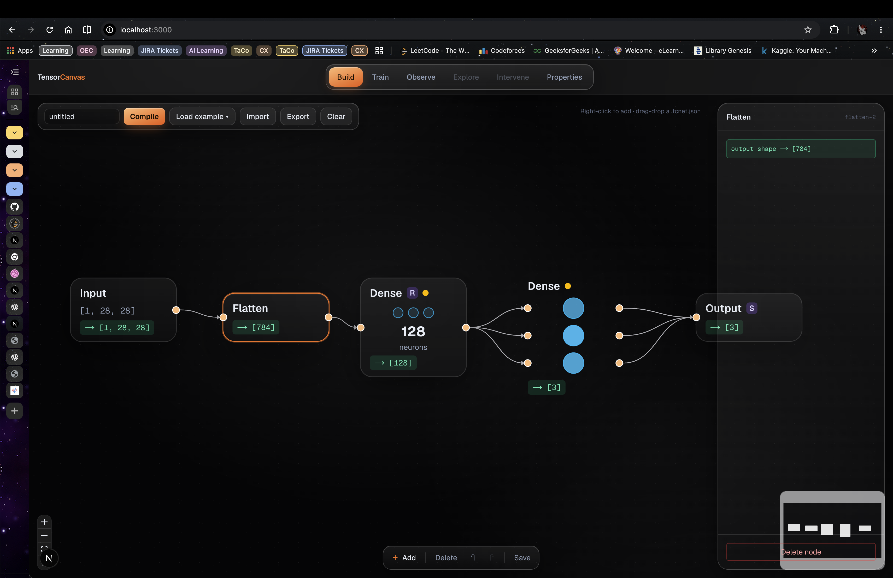
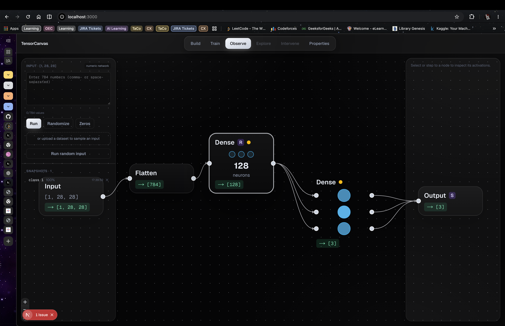
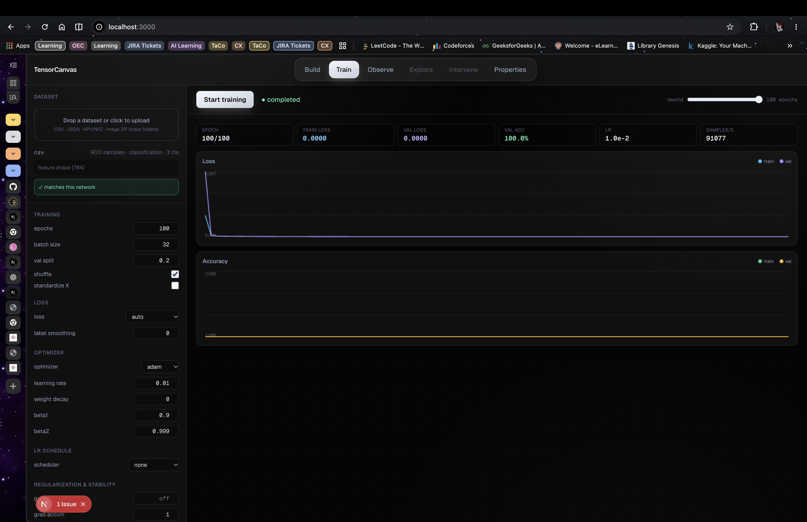

# TensorCanvas

### A visual neural-network exploration & intervention studio

**Explore. Understand. Intervene.**

[](./LICENSE)


TensorCanvas makes the internal computation of neural networks **understandable
and experimentally accessible**. Draw a network on a canvas, compile it into a
real PyTorch model, train it on your own data, then *watch the forward pass* —
which neurons fire, with what values, layer by layer — and **intervene** by
editing weights live to see how behaviour changes. All in the browser.

> **Status:** early development (0.1.0). APIs and file formats may change.

---

## Screenshots

| Build — visual network canvas | Observe — forward-pass + predictions |
|:---:|:---:|
|  |  |



> 📊 **Presentation:** a one-page slide deck is at [`docs/presentation.html`](docs/presentation.html) — open it in a browser.

---

## What you can do

- **Build** — draw networks node by node (Input, Dense, Conv2D, MaxPool2D,
  Flatten, Output, plus a free-form Custom node). Set per-neuron weights, bias,
  and activations.
- **Compile** — the graph is validated and built into a runnable PyTorch model;
  structural mistakes are reported against the exact node that caused them.
- **Train** — upload your own dataset (CSV / JSON / NPY / NPZ / image ZIP) or use
  a built-in generator; configure optimizer, loss, scheduler, epochs and batch
  size; watch training stream live with checkpoints and early stopping.
- **Observe** — run the model on a single input and replay the forward pass with
  per-neuron activations and labelled predictions; save a snapshot of every run.
- **Intervene** — edit weights live (in place, no rebuild) and re-run to compare.
- **Pretrained** — load real pretrained **AlexNet** or **VGG-16** weights
  (torchvision) and classify an image into ImageNet classes with top-k labelled
  predictions.
- **Share** — export/import architectures as `.tcnet.json`.

## Repository layout

```
tensorcanvas/
├── client/        # Next.js + TypeScript + Tailwind frontend (the studio UI)
├── server/        # Python backend (uv-managed) — model build, train, observe
├── sample-data/   # dataset generator + example datasets + alexnet.tcnet.json
├── docs/          # extension recipes (add a layer / dataset / pretrained model)
├── dev.sh         # one command to run the whole app
├── ARCHITECTURE.md
└── CONTRIBUTING.md
```

## Prerequisites

- **Node.js** 20+ with **Corepack** (`corepack enable` → provides Yarn 4)
- **uv** (Python package/runtime manager) — https://docs.astral.sh/uv/
- **Python** 3.12 (uv fetches it automatically)
- **Git**

## Quickstart

```bash
./dev.sh
```

On first run it installs dependencies for both sides (the Python side pulls
PyTorch/torchvision CPU wheels — hundreds of MB, so the first `uv sync` is slow),
then starts:

- **Frontend** → http://localhost:3000
- **Backend**  → http://localhost:8000  (interactive API docs at `/docs`)

Press **Ctrl+C** to stop both.

## Configuration

Nothing is required to run locally — the defaults work. To override, copy the
example env files (none contain secrets; they are host/port settings only):

| File                 | Key                   | Default                 | Purpose                               |
|----------------------|-----------------------|-------------------------|---------------------------------------|
| `client/.env.example`| `NEXT_PUBLIC_API_URL` | `http://localhost:8000` | Backend base URL the browser calls    |
| `server/.env.example`| `HOST`                | `127.0.0.1`             | Interface the backend binds to        |
| `server/.env.example`| `BACKEND_PORT`        | `8000`                  | Backend port                          |
| `server/.env.example`| `CORS_ORIGINS`        | `localhost:3000`        | Allowed browser origins (comma-sep.)  |
| `.env.example` (root)| `FRONTEND_PORT`       | `3000`                  | Frontend port (used by `dev.sh`)      |

Copy `client/.env.example` → `client/.env.local` and `export` the server vars (or
set them inline) as needed. See the comments in each file.

## A 2-minute tour (pretrained AlexNet)

1. `./dev.sh`, open http://localhost:3000.
2. **Build** tab → **Load example** → **CNN → AlexNet** (draws the AlexNet graph)
   → **Compile**.
3. **Observe** tab → **Load pretrained AlexNet weights** (first time downloads
   ~233 MB) → **Upload an image** → the forward pass animates and the top-5
   ImageNet predictions appear.

A fuller walkthrough (incl. training an ANN/CNN end-to-end) is in the project
notes; see also [`sample-data/README.md`](./sample-data/README.md) and the
step-by-step [manual testing & running guide](./docs/MANUAL-TESTING.md).

## Development

| | Frontend (`client/`) | Backend (`server/`) |
|---|---|---|
| Install | `yarn install` | `uv sync` |
| Run | `yarn dev` | `uv run tensorcanvas-server` |
| Build | `yarn build` | — |
| Lint | `yarn lint` | — |
| Test | — | `uv run pytest` |

## Architecture & contributing

- **[ARCHITECTURE.md](./ARCHITECTURE.md)** — how the pieces fit, the `.tcnet.json`
  data model, and known coupling points.
- **[CONTRIBUTING.md](./CONTRIBUTING.md)** — dev setup, tests, and a *"where to
  contribute"* map. TensorCanvas is built to be extended — adding a **layer
  type**, **dataset format**, **pretrained model**, or **example network** each
  has a step-by-step recipe in [`docs/`](./docs/).

## Tech stack

- **Frontend:** Next.js 16, React 19, TypeScript, Tailwind CSS v4, Zustand,
  React Flow (`@xyflow/react`).
- **Backend:** Python 3.12, FastAPI, Uvicorn, PyTorch (CPU), torchvision, NumPy,
  Pillow — managed by `uv`.

## License

Licensed under the **Apache License 2.0** — see [LICENSE](./LICENSE) and
[NOTICE](./NOTICE). Apache-2.0 is permissive (you can freely use, modify, and
redistribute, including building new modules) and includes an explicit patent
grant. Pretrained weights are downloaded from torchvision at runtime and are
**not** redistributed by this project; they carry torchvision's BSD-3 license and
ImageNet's non-commercial research/education terms.

## Citation

If you use TensorCanvas in research or teaching, please cite it — see
[CITATION.cff](./CITATION.cff).

## Authors

- **Swapnil Kapale** ([@Swapnil-Kapale](https://github.com/Swapnil-Kapale))
- **Aryan Tandon** ([@AryTan003](https://github.com/AryTan003))
